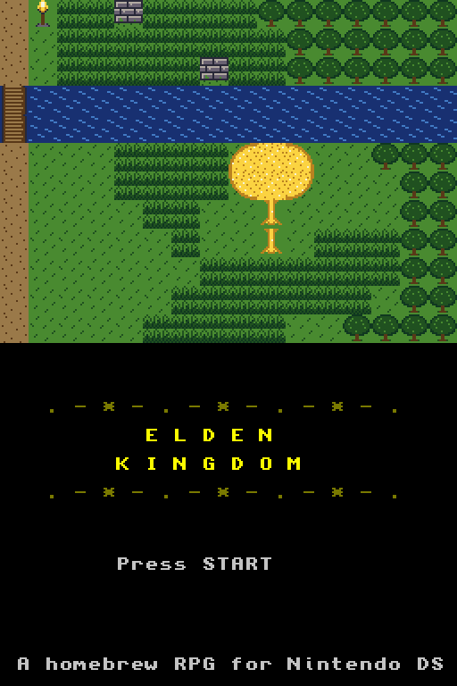
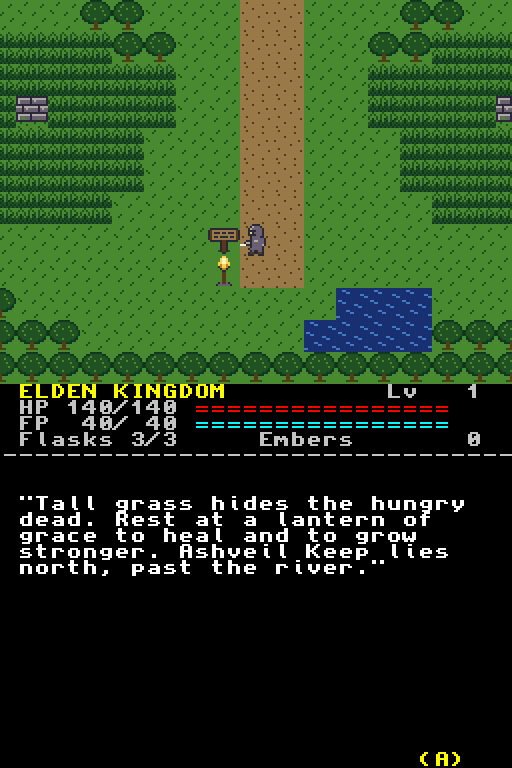
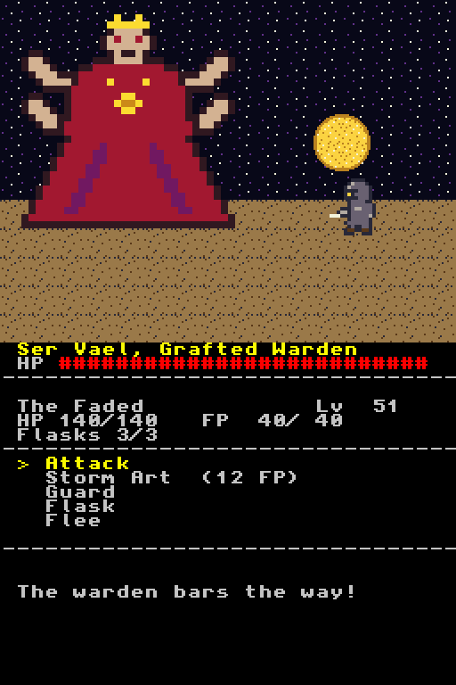

# Elden Kingdom

A small dark fantasy RPG for the Nintendo DS, in the style of the classic
Final Fantasy games and inspired by Elden Ring. You explore on the top
screen, and menus and battles play out on the bottom screen.

  

## Chapter 1: The Weeping Fields

You are one of the Faded, called back from death. Cross the fields, rest
at lanterns of grace, grow stronger and break the warden of Ashveil Keep.

- **Explore:** a scrolling overworld with a river, ruins, a golden tree, chests and a signpost.
- **Random encounters in tall grass**, with tougher foes the further north you go.
- **Turn-based battles:** Attack, Storm Art (FP), Guard, Flask, Flee.
- **Lanterns of grace:** heal, refill flasks and spend embers to level Vigor, Strength, Mind or Endurance.
- **Falling has a cost:** you drop your embers where you fell. Walk back to recover them.
- **Boss:** Ser Vael, the Grafted Warden, whose Grafted Flurry you'll want to Guard.

All names, story and art are original. All the pixel art is written as
text in `source/art.c`, so you can edit it in any text editor.

## Controls

| Button | Action |
| --- | --- |
| D-pad | Walk, move cursor |
| A | Talk, open, confirm |
| B | Back |
| START | Start game |

## Building

You need [devkitPro](https://devkitpro.org/wiki/Getting_Started) with the
`nds-dev` group installed, or Docker:

```sh
make                      # with devkitARM installed
docker run --rm -v "$PWD:/src" -w /src devkitpro/devkitarm make   # with Docker
```

This produces `elden-kingdom.nds`. Run it in [melonDS](https://melonds.kuribo64.net/)
or copy it to a flashcart. `make DEBUG=1` builds a dev version that starts
by the keep, already strong and with embers to spend.

Every push builds the ROM on GitHub Actions, and the `.nds` file is
attached to the run as a downloadable artifact.

## Layout

| File | What it does |
| --- | --- |
| `source/main.c` | Game loop, exploring, lanterns, chests, death, title and ending |
| `source/battle.c` | Turn-based battles |
| `source/gfx.c` | Top screen: tiles, map, sprites, camera |
| `source/ui.c` | Bottom screen: status, messages, menus |
| `source/map.c` | The world map, as text |
| `source/art.c` | Palettes and all pixel art, as text |
